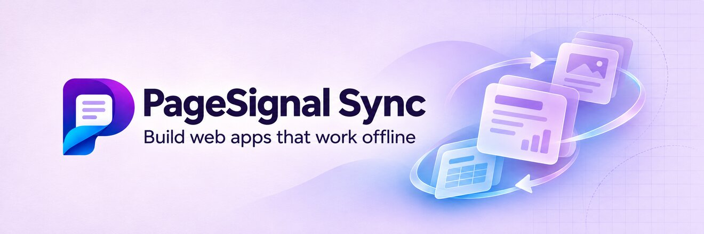

# PageSignal Sync



An experimental open-source TypeScript library for adding offline writes to web apps. Records live in IndexedDB, queries react to changes, and apps can explicitly sync through an HTTP adapter. The inventory example uses the same data layer in React, Angular, and Vue.

## Run the browser examples

From this folder, using Node.js 24:

```sh
npm ci
npm test
npm run build
npm run preview
```

Open [React](http://localhost:4173/demo/react.html), [Angular](http://localhost:4173/demo/angular.html), or [Vue](http://localhost:4173/demo/vue.html). Set Widget to 1. Once the service worker is active, go offline, increment it, and reload. The quantity persists. The built examples preload their app shell so it can reopen offline. The development server is useful for editing examples.

## Run sync against your own PostgreSQL instance

Run `docker compose up --build` in this folder. The sample server binds to localhost, uses its own PostgreSQL volume, and defaults to the sample token `local-demo`. Alternatively, provision a separate PostgreSQL database, set `DATABASE_URL`, `SYNC_MODE=demo`, and `SYNC_TOKEN`, then run `npm run server`. The server creates its own tables on startup. Set `SYNC_ORIGIN` if your demo runs on a different origin. Set `VITE_SYNC_URL` before building to point the demo at a different server.

1. Open the demo in two separate browser profiles. Framework demos in the same profile share the local database.
2. Create a Widget in one profile and select **Sync now**. Use the same token to sync the second profile.
3. Edit the Widget in both profiles. Sync one, then the other. The second profile shows the rejected local value and the server value.
4. Choose **Keep local** to queue that value again, or **Keep server** to dismiss it. Sync again to share the chosen value.

## Use the TypeScript API

Install the developer preview with `npm install @pagesignal/sync`.

```ts
import { SyncDatabase, httpTransport } from '@pagesignal/sync';

const db = new SyncDatabase<{ tasks: { title: string; done: boolean } }>('my-app');
const tasks = db.collection('tasks');
const subscription = tasks.watch().subscribe(({ records, conflicts }) => {
  console.log(records, conflicts);
});

await tasks.put('task-1', { title: 'Count inventory', done: false });
await db.sync(httpTransport('http://localhost:8787', () => sessionToken));

// On teardown:
subscription.unsubscribe();
db.close();
```

Use a distinct database name for each local account and remote dataset. The SDK uses browser Web Locks for cross-tab sync, and requires localhost or HTTPS. Use JSON-compatible values. The SDK type-checks collection records in TypeScript. Runtime application schema validation belongs in the app and its backend.

## Authenticated self-hosting

The server defaults to JWT authentication. Set `DATABASE_URL`, `SYNC_JWT_ISSUER`, `SYNC_JWT_AUDIENCE`, `SYNC_JWKS_URL`, and `SYNC_ORIGIN`. The keys URL must use HTTPS. Run `npm run server` behind your HTTPS reverse proxy. Set `HOST` explicitly if your container runtime needs the API to listen on a different interface.

Configure a trusted issuer to sign RS256 access tokens with the configured issuer and audience, an expiration, a stable subject (`sub`), and a server-assigned tenant identifier (`tenant_id`). Use a dedicated audience for this service. The issuer determines tenant membership. Each tenant and subject pair owns a separate dataset. The same signed-in user can sync across devices, and each user's records, revisions, and checkpoints are isolated. Shared datasets and cross-user collaboration require a separate authorization model.

Use a database name derived from your authenticated account, tenant and deployment identity. Keep the token supplier bound to that same session. On logout or account switch, stop automatic sync, unsubscribe, and close the old database before opening a new one. IndexedDB data persists on the device after logout unless the application explicitly deletes it.

When upgrading the local demo from the prototype, stop all old server instances before starting this version. The first startup copies the demo's existing records, history, and checkpoint into the dedicated demo scope. Authenticated accounts start with separate datasets.

## Recover automatically after reconnecting

Pass a session-bound transport to the SDK after the app signs in. Automatic sync runs at startup, when local edits are queued, and when the browser reconnects.

```ts
const transport = httpTransport(serverUrl, getTokenForCurrentSession);
const sync = db.startAutoSync(transport, (status) => console.log(status.state));

// After repairing credentials or another blocking error:
sync.retry();

// On logout or component teardown:
sync.stop();
```

The SDK reports offline, syncing, idle, retrying, and blocked states. Network errors, timeouts, HTTP 408/429, and server errors are retried with capped exponential backoff and jitter. Other failures pause until the app calls `retry()`. Pending edits remain in IndexedDB. The SDK coordinates sync passes across tabs through Web Locks. Automatic sync is opt-in, and the inventory examples retain their manual Sync now control for reproducing conflicts. Remote changes are pulled during sync passes.

## Recover after a PostgreSQL restore

1. Stop all sync API instances and restore the backup into your target database. Keep writes paused until the restored database is ready.
2. If the backup predates checkpoint recovery, initialize the database with the updated server and stop it before allowing clients to connect.
3. Rotate the restored database’s history ID before reopening traffic.

```sql
UPDATE sync_history SET id = gen_random_uuid() WHERE singleton = true;
```

4. Start the updated API and reconnect clients with the updated SDK. A recovery-aware client discards its cached server records, pulls from the start of the restored change feed, and retains queued writes and local conflict drafts. Edits based on a revision missing from the backup surface as conflicts.

The backup defines the restored state, including deletions recorded in that backup. Recover changes and deletions made after the backup through PostgreSQL point-in-time recovery or a separate audit trail. The SDK can replay unsent edits still on a device. Acknowledged edits beyond the backup may require database recovery.

To rehearse locally, sync two inventory browser profiles, delete a record, take a PostgreSQL backup, then let one profile go offline. Edit an existing record and add a new one in that profile. Restore the backup to a disposable database, rotate its history ID, and reconnect to the restored server. Check that the deleted record remains absent, the queued new record reaches both profiles, and any edit based on a missing revision is offered for conflict resolution. Run `npm test` for the automated rewind and replay scenario.

## HTTP protocol

- `POST /push` accepts `{collection, id, value, revision, expected}`. A null value represents a deletion. The UUID revision doubles as the write receipt. The expected revision is null for an unseen record. A stale write returns `{ok: false, remote}` so the client can preserve the intended edit while displaying the latest server record.
- `GET /pull?cursor=0` returns `{cursor, changes}`. Cursors are opaque decimal strings. Pull again with the returned cursor until the server returns an empty page. Keep deletion entries in the feed. Recovery-aware clients include `checkpoint=1` plus their last `history` and `revision` when available. The server returns its history ID and a `reset` flag. A cursor beyond the restored head, a different history ID, or a mismatched revision at the same cursor requires replay from zero. Existing custom transports can opt into pull-before-push by setting `checkpointRecovery: true` and returning this metadata.
- Both routes require a bearer token. Use the same protocol to connect the SDK to your own backend.

Use demo mode for local evaluation. Its shared token grants access to the demo dataset. Use JWT mode for authenticated deployments. The reference server retains the full change log for replay and write receipts. Log compaction and migrations between deployments are pending. The package uses the repository’s MIT license.
